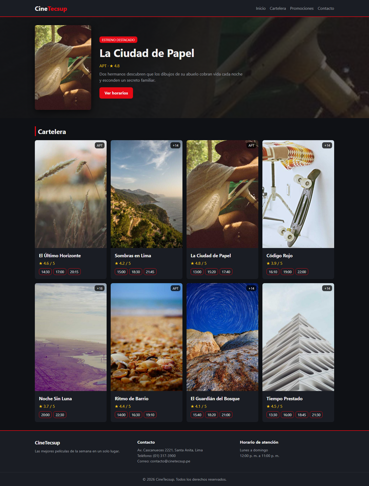

# CineTecsup - Laboratorio 09

Cartelera de cine hecha con React y Vite para el curso Desarrollo de Aplicaciones Empresariales.

## Cómo ejecutarlo

Probado con Node.js v24.15.0 y npm 11.12.1.

```bash
npm install
npm run dev
```

## Estructura

```
src/
├── components/
│   ├── Header/      nombre del cine y navegación
│   ├── Hero/        banner de la película destacada (recibe movie por props)
│   ├── MovieList/   recorre la cartelera con map (recibe movies por props)
│   ├── MovieCard/   tarjeta de una película (recibe movie por props)
│   └── Footer/      contacto e información
├── data/
│   └── movies.js    cartelera con 8 películas
├── styles/
│   ├── variables.css
│   ├── base.css
│   ├── layout.css
│   └── index.css
├── App.jsx          compone todos los componentes
└── main.jsx
```

App.jsx importa los datos y los pasa hacia abajo: la película destacada a Hero y la cartelera completa a MovieList, que a su vez le pasa cada película a MovieCard.

## Dependencias

- react, react-dom
- vite, @vitejs/plugin-react

## Capturas



[Ver la captura completa en móvil](docs/capturas/cartelera-movil.png)

## Observaciones

- **App.jsx** es el único componente que conoce el archivo de datos. Elige la película
  destacada y entrega `movie` a `Hero` y la cartelera completa a `MovieList`.
- **MovieList** recibe `movies`, la recorre con `map` y crea un `MovieCard` por película con
  `key={movie.id}`. No importa los datos ni conoce cómo se obtuvieron.
- **MovieCard** recibe solo `movie` y dibuja imagen, título, clasificación, valoración y
  horarios. Los horarios se recorren con `map` y usan el propio horario como `key`.
- **Hero** recibe la película destacada por props y no sabe si viene del archivo o de una API.
- **Header** y **Footer** no reciben datos: solo muestran la marca, la navegación y el
  contacto, así que se pueden reutilizar en cualquier página del cine.
- **CSS**: `variables.css` guarda colores y medidas, `base.css` hace el reset, `layout.css`
  define el contenedor y los títulos de sección, y cada componente tiene su propio archivo
  importado desde su `.jsx`. `styles/index.css` reúne las tres bases y lo importa `main.jsx`.
- **Responsive**: agregué media queries en Header, Hero y Footer para que la navegación, el
  banner y el pie se apilen en pantallas de menos de 640 px.
- Los tres errores típicos del paso 11 y el mensaje exacto de cada uno están en
  [docs/errores.md](docs/errores.md).

## Checklist del laboratorio

- [x] 1. Proyecto creado con `npm create vite@latest` (plantilla React), dependencias
      instaladas y servidor levantado con `npm run dev`.
- [x] 2. Plantilla limpia: `index.html`, `src/main.jsx` y `src/App.jsx` con lo mínimo.
- [x] 3. `src/` organizado en `components`, `data` y `styles`, con la arquitectura CSS.
- [x] 4. Archivo de datos con ocho películas (título, imagen, sinopsis, clasificación,
      valoración y horarios).
- [x] 5. Header con nombre del cine y navegación.
- [x] 6. Footer con contacto e información.
- [x] 7. Hero con la película destacada recibida por props.
- [x] 8. MovieCard con imagen, título, valoración y horarios.
- [x] 9. MovieList con `map` y `key` por película.
- [x] 10. Composición en `App.jsx` y verificación en el navegador.
- [x] 11. Tres errores provocados y documentados con su mensaje.
- [x] 12. Repositorio con código, capturas y observaciones.

